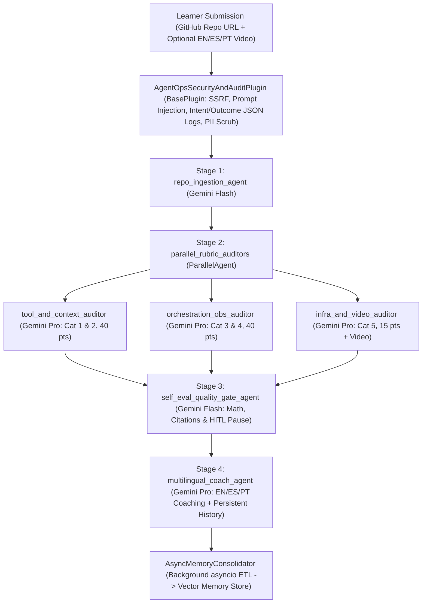

# AI in 5 Days Multilingual Assessment Agent (Google ADK)

A production-grade, multilingual (**English, Spanish, and Portuguese**) **AgentOps Assessment Agent** built with **Google Agent Development Kit (ADK 2.0)**. It audits public AI agent GitHub repositories and optional walkthrough videos against the **95-point AgentOps Code Review Matrix**, delivering cited scores, prioritized remediation guides, and Human-in-the-Loop (HITL) governance.

> Built for the **AI in 5 Days (GEAP & AI Coding)** Capstone — directly answering the FAQ invitation to build multilingual assessment tooling so LATAM / Spanish- and Portuguese-speaking learners can pre-audit their agents before official submission.

## Multi-Agent Architecture



## 95-Point AgentOps Code Review Matrix Mapping

Every single one of the **19 criteria (95/95 points)** is implemented as verifiable code in this repository:

| Category | Criterion (5 pts) | Implementation Path |
| :--- | :--- | :--- |
| **1. Tool & Interface Design** | Comprehensive Tool Docstrings | `assessment_agent/tools/repo_tools.py`, `video_tools.py`, `hitl_tools.py` |
| | Descriptive Naming | `clone_and_index_public_github_repo`, `scan_repo_for_agentops_evidence`, `read_repo_file_line_range`, `audit_repo_for_hardcoded_secrets_and_risks`, `analyze_multilingual_walkthrough_video`, `save_assessment_report_to_history`, `request_human_certification_override` |
| | Explicit JSON Schemas | `assessment_agent/schemas/models.py` (strict Pydantic v2 `ConfigDict(extra="forbid")`, score & subtotal validators) |
| | Guided Error Handling | `ToolErrorResult` with `error_code` + actionable `recovery_instructions` on every failure branch |
| **2. Context & Memory** | Robust System Instructions | `assessment_agent/prompts/constitutions.py` (6 specialist constitutions with untrusted-repo injection immunity) |
| | History Compaction | `assessment_agent/memory/compaction.py` (`EventsCompactionConfig`, `ContextCacheConfig`, `SlidingWindowHistoryCompactor`) |
| | Persistent Session State | `assessment_agent/app.py` (`DatabaseSessionService` / `VertexAiSessionService`) + `assessment_agent/memory/store.py` (SQLite + vector embeddings) |
| | Async Memory Operations | `assessment_agent/memory/async_consolidator.py` (`asyncio.create_task` background ETL + `VertexAiMemoryBankService`) |
| **3. Orchestration & Logic** | Multi-Agent Patterns | `assessment_agent/agent.py` (`SequentialAgent` Coordinator + `ParallelAgent` 3-specialist audit panel) |
| | Strategic Model Routing | `assessment_agent/config/settings.py` (`gemini-2.5-flash` for ingestion/triage/self-eval vs. `gemini-2.5-pro` for deep audits & coaching) |
| | Guardrails & Policy Plugins | `assessment_agent/plugins/security_guardrails.py` (`BasePlugin`, SSRF allowlist, prompt-injection detection, Model Armor hook) + `self_eval_quality_gate_agent` |
| | Human-in-the-Loop Hooks | `assessment_agent/tools/hitl_tools.py` (`ToolContext.request_confirmation` pause/resume gate for leaked secrets, borderline 70–79 scores, or official badge publish) |
| **4. Observability & Tracing** | Structured JSON Logging | `assessment_agent/observability/logging.py` (`StructuredJsonFormatter` compatible with Cloud Logging; zero `print()` calls) |
| | Intent vs. Outcome Capture | `assessment_agent/plugins/security_guardrails.py` (`before_tool_callback` logs `tool_intent`; `after_tool_callback` logs `tool_outcome` + latency) |
| | Distributed Tracing | `assessment_agent/observability/tracing.py` (OpenTelemetry `TracerProvider` + `CloudTraceSpanExporter` + `enable_tracing=True`) |
| | PII Redaction | `assessment_agent/observability/pii_redactor.py` (deterministic regex + optional Google Cloud DLP `DlpServiceClient` scrubbing logs, traces, and memory) |
| **5. Infrastructure & CI/CD** | Automated Evaluation Suites | `evals/golden_dataset.json`, `evals/run_eval.py`, `tests/`, and `.github/workflows/ci.yml` |
| | Infrastructure as Code | `terraform/*.tf`, `Dockerfile`, `Makefile`, and `docs/deployment_agents_cli.md` (Terraform + `uvx google-agents-cli`) |
| | Secure Secret Management | `assessment_agent/config/secrets.py` (Google Cloud Secret Manager; zero hardcoded keys) |

## Quick Start

```bash
# 1. Install dependencies in a virtual environment
python3 -m venv .venv && source .venv/bin/activate
pip install -e ".[dev]"

# 2. Run unit tests and the automated golden regression eval suite
make test
make eval

# 3. Launch the local ADK web playground (requires .env or GCP ADC)
cp .env.example .env
adk web .
```

See [docs/deployment_agents_cli.md](docs/deployment_agents_cli.md) for Terraform provisioning and Google Agents CLI / Vertex AI Agent Engine deployment instructions.
